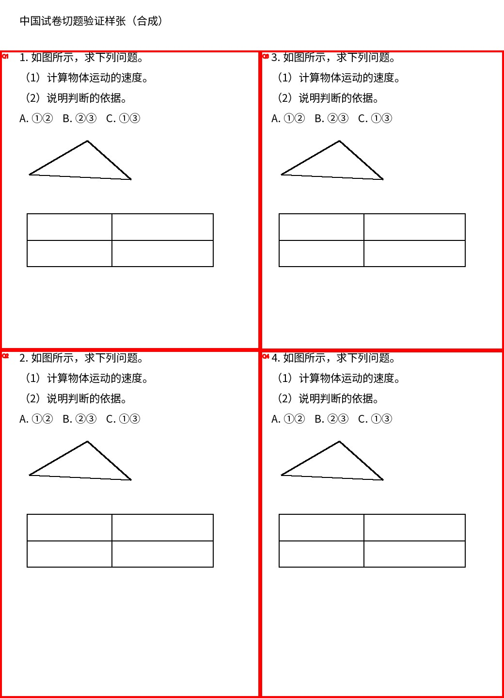

# Exam Splitter · 试卷切题工具

基于本地 OCR 的试卷题号、分栏、阅读顺序与题目区域处理工具。使用 Python 和 RapidOCR，在 CPU 上输出上传图片坐标系中的题框。项目包含规则实现、单元测试和可复现的合成试卷示例。

**当前状态：独立提取的研究与演示工具，需要人工检查结果。** 不提供自动批改、可靠公式转写、跨页拼题或线上服务。没有打包真实试卷、学生数据、客户配置、模型权重或原项目 Git 历史。

## 功能

- 识别 `12.`、`12、`、`例8`、`第12题` 等主问题标记，避免将 `(1)`、选项或图注直接当作新题。
- 按栏从左到右、栏内从上到下排列。以 OCR 证据处理题号重复与冲突，不凭空补齐题号。
- 输出像素题框；可选版面适配器支持配图保护、多区域组合及阅读顺序处理。
- 无可靠题号时返回空结果和警告；保留图形、表格及转写不确定性供人工核对。
- 默认模型从已安装的 RapidOCR 包读取，默认推理路径不发送图片、不调用云端 API。

## 合成演示



示例由 `evaluate.py` 生成，题干、图形和空表格均为合成内容，不是学生作业或第三方试卷。

2026-11-07 在 Windows、Python 3.12.14、CPU、默认 ONNXRuntime 路径实跑：

| 输入 | 结果 | 人工复核重点 |
| --- | --- | --- |
| [合成双栏页](examples/input/synthetic_two_columns.jpg) | 4 个题框，顺序为 1、2、3、4 | 左栏先于右栏；框保留图形与空表格 |
| [无主题号续页](examples/input/synthetic_continuation.jpg) | 0 个题框，要求人工框选 | 不把 `(1)`、`(2)` 当作主题号 |

[完整结果 JSON](examples/synthetic/results.json)。这两页只能展示行为，不构成真实试卷准确率基准。圈号 `①②` 在 OCR 文本中变成 `12`，选项也可能连在一起；输出会保留相关警告，原始图片始终是依据。

## 安装

建议 Python **3.12**，单独创建环境。从仓库根目录运行：

```sh
python -m venv .venv
# Windows PowerShell
.venv/Scripts/python -m pip install -r requirements.txt
.venv/Scripts/python -m pip check
.venv/Scripts/python -m unittest discover -s . -p "test_*.py"
.venv/Scripts/python evaluate.py --images examples/input --output output/demo
```

Linux/macOS 将 `.venv/Scripts/python` 改成 `.venv/bin/python`。本次验收在 Windows 完成，未验证其他操作系统。安装需要访问包仓库；第一次安装下载包含模型的 RapidOCR wheel，模型不会由本工具在默认推理时自动下载。

`requirements.txt` 固定本次测试环境版本。可选 Paddle/OpenVINO/新版布局与表格依赖不要直接混装到已运行环境，见 [运行方式与实验边界](docs/RUNTIME.md)。

## 最小 Python 接入

```python
import base64
import hashlib
from pathlib import Path
from PIL import Image
from worker import process_page

path = Path("examples/input/synthetic_two_columns.jpg")
data = path.read_bytes()
with Image.open(path) as image:
    width, height = image.size
request = {
    "version": 1,
    "pageId": "synthetic-demo",
    "imageHash": hashlib.sha256(data).hexdigest(),
    "width": width,
    "height": height,
    "images": [{"mime": "image/jpeg", "base64": base64.b64encode(data).decode()}],
}
result = process_page(request)
print([(b["printedNumber"], b["bbox"]) for b in result["blocks"]])
```

输入限单张 JPEG，最长边不超过 2048 像素，文件不超过 1,572,864 字节。实际像素、声明尺寸、SHA-256 必须一致；EXIF 方向应事先归一化。输出 `coordinateSpace` 是 `uploaded-image`，题框为像素，不是 0–1000 归一化坐标。

也可向 `worker.py` 的 stdin 发送同一 JSON，从 stdout 获取结果。`worker.py --serve` 接受逐行 `{ "id": "request-1", "input": request }`，串行复用模型。无题框不代表图片无题，必须处理警告并提供人工框选。

## 已知限制

- 清晰、正向、印刷体、单栏或常见双栏效果更可预测。多栏复杂排版、斜拍、模糊、阴影、裁边、跨栏材料和共享图形可能失败。
- 检测器不理解题意；题号、图注或配图归属可能错，某栏缺少题号可能漏检。
- 公式、科学符号、手写文字和表格数值不能可靠转写，不能用作自动判卷依据。
- `questionText` / `options` 是带警告的 OCR 拼装，不保证完整。`studentAnswer` 不自动推断。
- 原始代码中的“需云端核对”只是警告文字，本仓库没有云服务凭据，也不会因此自动调用云服务。
- 可选模型路径仅保留适配代码，不意味着相应模型或真实样本已在本次发布中验收。
- 文件输出工具会在指定输出目录写文件，请使用新的目录，不要指向原始样本目录。

## 来源、许可证与验证

- [第三方依赖与模型说明](THIRD_PARTY_NOTICES.md)：框架、权重来源、下载入口、许可证和 SHA-256。
- [验证记录](docs/VALIDATION.md)：170 项单元测试、合成推理结果及未验证范围。
- [运行与可选实验](docs/RUNTIME.md)：参数、模型下载、离线边界。

项目代码采用 [MIT 许可证](LICENSE)。第三方依赖、模型和字体仍按各自许可证使用，MIT 不替代这些许可。

